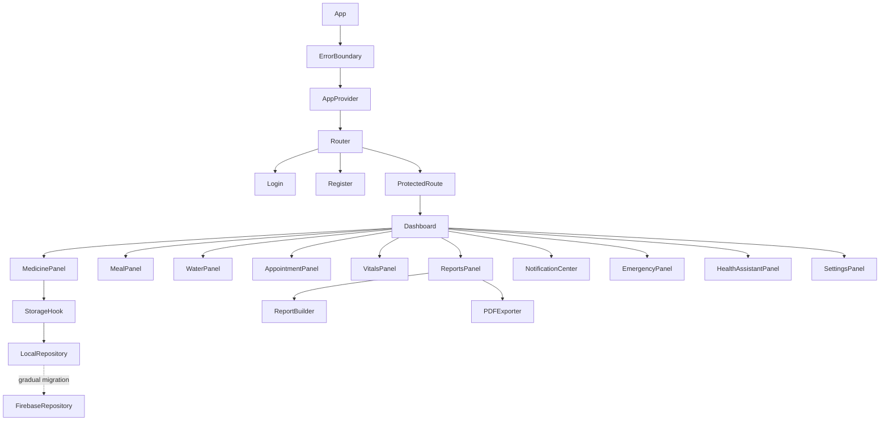
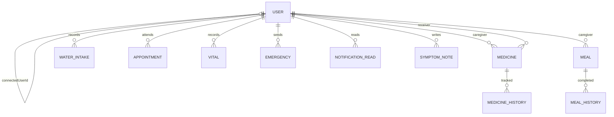
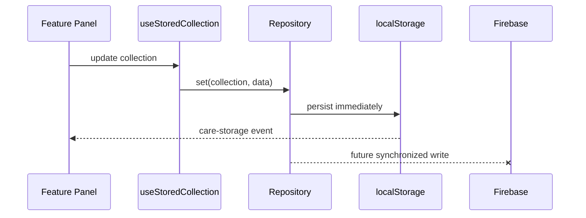

# Architecture

## Folder structure

```text
care-for-shweta/
├── public/
│   ├── manifest.webmanifest
│   └── sw.js
├── src/
│   ├── components/       Reusable feature panels and UI primitives
│   ├── constants/        Storage keys and stable application constants
│   ├── context/          Global user and theme state
│   ├── hooks/            Storage, app context, and install hooks
│   ├── pages/            Route-level screens
│   ├── routes/           Route protection
│   ├── services/         Storage, repositories, Firebase, and AI adapters
│   └── utils/            Dates, reports, validation, and PDF export
├── .env.example
└── README.md
```

## Component diagram



## Data model



All care records carry `caregiverId` and `receiverId` where applicable. This
pair boundary prevents records from different care circles from appearing
together.

## Data flow



## Firebase migration phases

1. Configure Firebase project, Auth providers, Firestore, Storage, and rules.
2. Move login and registration to Firebase Authentication.
3. Add a Firebase repository implementing `get`, `set`, and `subscribe`.
4. Migrate one collection at a time while local records remain readable.
5. Upload profile images to Cloud Storage and store only URLs in user documents.
6. Add migration versioning, conflict handling, audit logs, and deletion jobs.

## Accessibility and performance

- Semantic headings, buttons, forms, labels, status regions, and focus rings
- Responsive navigation for mobile, tablet, and desktop
- Route and panel lazy loading with Suspense skeletons
- Feature-level localStorage subscriptions instead of a large global data store
- Reduced initial JavaScript through Vite code splitting

## Future scope

- Secure caregiver invitations and multi-caregiver care circles
- Clinician portal and interoperable health-record imports
- Push notifications through Firebase Cloud Messaging
- Encrypted backups, audit trails, and regional data residency
- Verified medicine database and drug interaction checks
- Server-side OpenAI assistant with retrieval, moderation, and clinical escalation
- Automated testing, observability, analytics, and deployment pipelines
